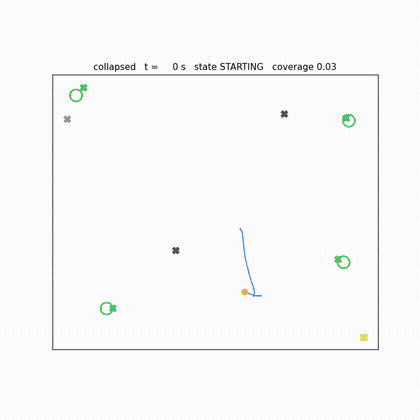

# Autonomous search-and-rescue robot (simulation)

A ground robot in Gazebo explores unknown disaster-like worlds, maps them, finds people with a camera and
drops a pin on the map for each survivor. ROS 2 Jazzy, Gazebo Harmonic, slam_toolbox, Nav2, YOLOv8n,
py_trees. Everything runs headless under WSL2 (Ubuntu 24.04) and is scored by an automated evaluation harness.



*One mission replayed from its rosbag (`docs/media/demo.mp4`): the SLAM map growing, the robot (orange) and
its path (blue), pins (yellow = candidate, red = confirmed, green = verified, grey = rejected) and the true
survivors (green circles).*

## What it does
```
sensors (2D lidar, RGB-D camera, IMU, wheel odometry)
  -> EKF (robot_localization) -> slam_toolbox (live map)  -> hazard layer (narrow passages)
  -> YOLOv8n fine-tuned on synthetic frames -> survivor localizer (depth back-projection, tracking,
     confirm after N hits, close-range verification)
  -> frontier selector (unknown area gain / path length, hazard penalty, Nav2 path costs)
  -> mission behaviour tree: TimeLimit > Recover > Verify > Explore > Finish  -> Nav2 -> /cmd_vel
```
- **Worlds**: three generated worlds (collapsed, rooms, open_plan) with known survivor poses (`rescue_simulation`).
- **Mission tree** (`rescue_mission`): explores until no frontier is left (DONE), recovers from stuck robots,
  localization jumps, kidnaps (scan-to-map check, global search, SLAM re-seed) and unreachable goals, and
  drives to pins for a close verification view.
- **Evaluation** (`rescue_eval`): one command runs a seeded mission, records a bag, and appends a CSV row with
  coverage, time to 90 %, map IoU, ATE, pin precision/recall/duplicates/error, recoveries, mission outcome.
  Failure injection (`--inject block|teleport`) is built in.

## Results (measured; details in `docs/`)
The sweep and the week-8 failure tests ran before kidnap relocalization was added. It is now on by default;
`relocalization_enabled: false` in `src/rescue_mission/config/mission.yaml` restores the configuration they measured.

From the evaluation sweep, 60 runs, 3-5 seeds per cell (`docs/PHASE8.md`, tables in `docs/results/`):
- Fine-tuning YOLOv8n on synthetic frames raised survivor recall by **+0.61** over COCO weights
  (paired, 95 % CI +0.39 to +0.83); the pretrained model pinned survivors in 1 of 13 runs.
- With the fine-tuned detector, explore_lite and the own selector pinned every survivor in collapsed and
  open_plan (recall 1.00), with **0 duplicate pins** in every condition and pin error 0.18-0.50 m.
- The own mission tree ends missions by itself (DONE in 75-100 % of runs, 213-546 s); final coverage
  0.99-1.00 in collapsed and open_plan.
- Own selector vs explore_lite: own reached 90 % coverage 35 s sooner on average, **not significant**
  (95 % CI -113 to +42 s).
- Verification as built lowered recall by 0.22 (CI -0.41 to -0.03) without a measurable precision gain.
- Failure tests (`docs/PHASE7.md`): blocked corridor recovered in 5 of 5 runs; kidnapped robot (teleport)
  recovered in 0 of 5.
- Kidnap detection and global relocalization added afterwards (`docs/PHASE10.md`):
  - **Detection:** the scan is scored against the map. Live, it detected 5 of 5 kidnaps, with no false
    alarm in 5 kidnap-free missions. Its thresholds were tuned offline on 16 recorded missions
    (0 false alarms in those 8,072 normal scans).
  - **Live:** **1 of 5** teleports recovered (final error 0.11 m). That was the one run that landed
    in mapped space; the other 4 landed in unmapped space, where the robot correctly refused to
    re-seed.
  - **No regression:** blocked corridor 3 of 3, still no false alarms.
- 216 unit/integration tests pass (`colcon test`, simulation tests skipped).

## Limitations
- A kidnap into space the robot has not mapped yet is not recovered: the pose stays 4.6-9.9 m wrong
  (4 of 5 live teleports). Kidnaps into mapped space are recovered.
- The rooms world is weak for every explorer: ATE 0.4-1.5 m, map IoU 0.48-0.81, 3.5-5.2 recoveries per run (own mission).
- 3-5 seeds per condition, not the planned 10 (the sweep lost most of its time to simulator and DDS leaks,
  `docs/PHASE8.md`); most comparisons are not statistically separated.
- 1-3 false pins remain in some runs (obstacles that look like people); collapsed precision 0.64-0.92.
- Simulation only. Foxglove layout provided but not opened in Foxglove Studio here.

## Quick start
```bash
# Ubuntu 24.04 + ROS 2 Jazzy + Gazebo Harmonic, then:
cd ~/autonomous_rescue_robot
scripts/fetch_third_party.sh               # explore_lite at a pinned commit
rosdep install --from-paths src -y --ignore-src
colcon build && source install/setup.bash

# a live mission with the Gazebo 3D window open (WSLg on Windows 11, or any desktop)
scripts/gui_demo.sh collapsed

# whole system, headless (detector weights: train with scripts/train_detector.py, not in the repository)
ros2 launch rescue_bringup full_mission.launch.py world:=collapsed explorer:=own verify:=true \
    detector:=yolo model:=results/detector/runs/all_x/weights/best.pt

# one scored run
ros2 run rescue_eval explore_eval --world rooms --seed 1 --explorer own --detector yolo \
    --model results/detector/runs/all_x/weights/best.pt --no-plateau

# the sweep and its tables
scripts/sweep.sh 1 6 && python3 scripts/make_tables.py results/sweep docs/results

# tests
RESCUE_SKIP_SIM_TESTS=1 colcon test --packages-skip explore_lite explore_lite_msgs && colcon test-result
```
YOLO runs in its own venv (`~/venvs/yolo`, Ultralytics with CUDA).

## Repository
| path | contents |
|---|---|
| `src/rescue_description`, `rescue_simulation` | robot Xacro, sensors with noise, world generator, ground truth |
| `src/rescue_slam`, `rescue_mapping`, `rescue_navigation` | EKF + slam_toolbox, hazard layer, Nav2 config |
| `src/rescue_perception` | YOLO node, dataset tools, survivor localizer and tracker |
| `src/rescue_exploration`, `rescue_mission` | frontier selector, mission behaviour tree |
| `src/rescue_eval` | evaluation harness, metrics, failure injection |
| `src/rescue_bringup` | launch files (sim, mapping, full mission) |
| `docs/PHASE1..10.md` | per-phase results, reproduction commands, deviations, known issues |
| `docs/REPORT.md`, `docs/RESUME_CLAIMS.md` | final write-up; claims with their sources |
| `foxglove/` | Foxglove layout (`docs/FOXGLOVE.md`) |

## Licence notes
The code in this repository is MIT-licensed (`LICENSE`). Ultralytics YOLOv8 is AGPL-3.0; the detector node imports it at run time, so distributing this system with
the detector falls under AGPL terms. explore_lite (m-explore-ros2) is BSD; `scripts/fetch_third_party.sh` fetches it at a
pinned commit into `src/third_party` (not committed). Model weights, bags and datasets are not committed.
