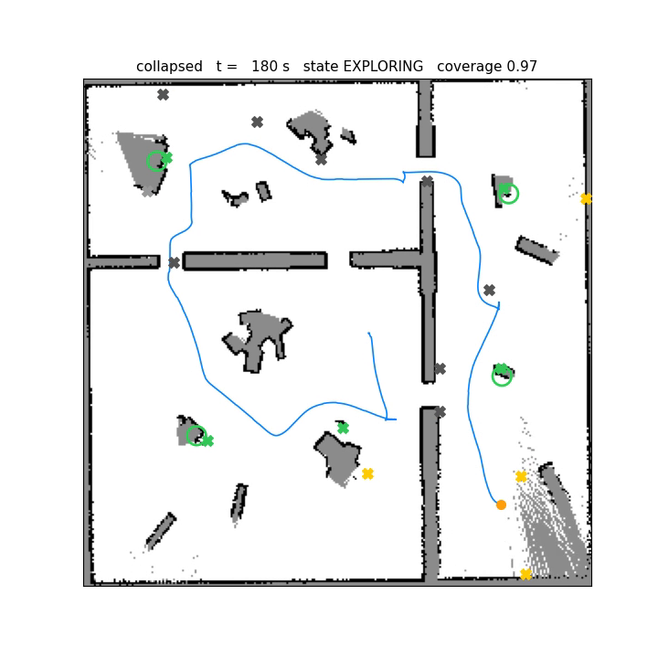

# Phase 9 (plan week 10): visualisation and demo

## Demo video
`docs/media/demo.mp4` (17.4 s, 720x720, 12 fps) is an offline replay of one sweep run
(`collapsed_ownverify_ft_seed1`, own selector + verification + fine-tuned YOLO), made from its rosbag with
```bash
source install/setup.bash
python3 scripts/render_demo.py results/sweep collapsed_ownverify_ft_seed1_20261123T224724Z docs/media/demo.mp4
```
It shows the SLAM map as it grows, the SLAM path (blue), the robot (orange dot), pins by state (yellow candidate,
red confirmed, green verified, dark grey rejected/merged), true survivors (green circles) and the mission state and
coverage in the title. `docs/media/demo_frame.png` is the frame at 15 s of video (180 s of mission).



## Foxglove
Layout `foxglove/rescue_layout.json`, described in `docs/FOXGLOVE.md`. It was **not** opened in Foxglove Studio
and no Foxglove screen recording exists: this environment has no display and foxglove_bridge is not installed.

## Plots
`docs/results/coverage_curves.png` (coverage vs time, per world and condition) and `docs/results/pins.png`
(pin precision/recall per condition), both from `scripts/make_tables.py`; week-7 curves in `docs/img/phase6/`.

## Known issues
- The video has no legend; colours are explained here.
- One run only; the bag-to-video script was run once (it worked first time after sourcing the workspace).
